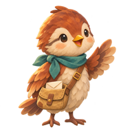
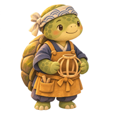
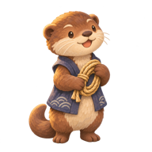
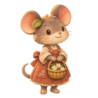
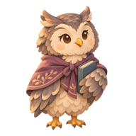

# Kigi — NPC-e i dialogi do mapy hiragany

Pakiet koncepcyjny v1 · 8 listopada 2026

**Status: materiały do dalszego wdrożenia.** Ten pakiet nie zmienia działającej aplikacji Flutter. Zawiera sześć statycznych postaci, opisy mieszkańców, dziesięć spotkań z grupami hiragany i propozycję rozmieszczenia na mapie.

Rozwija [zarys „Ścieżki lampionów”](../../fabula-kigi.md). Zachowuje Yuu, Minę, Tomę i motyw pustej strony notesu. Neri, Hana i Sora są nowymi propozycjami. W tej adaptacji Wieczór Lampionów kończy etap 46 podstawowych znaków; w pierwotnym zarysie następował po dakuten i handakuten. Starszy scenariusz pozostaje osobnym wariantem.

## Materiały

- [Pełny scenariusz i dialogi](scenariusz.txt).
- [Treści, kolejność wyzwań i pozycje NPC-ów w JSON](dialogi-i-npc.json).
- [Podgląd mapy i rozmów](mapa-i-dialogi.html) — pobierz plik i otwórz w przeglądarce. Kliknij imię postaci; listą „Spotkanie” wybierzesz jej kolejne rozmowy. To podgląd treści, bez działających ćwiczeń językowych.
- [Mapa odniesienia](map-reference.png).
- [Oryginalne grafiki PNG](npc/) i [pomniejszone podglądy](podglady/).
- [Prompty graficzne](prompty-graficzne.json), [parametry grafik](kontrola-grafik.json) i [manifest plików](manifest.json).

## Mieszkańcy

| Yuu — szkoła | Mina — poczta | Toma — pracownia |
|---|---|---|
|  |  |  |
| Liściasty opiekun szkoły z notesem. | Ptasia listonoszka z torbą. | Żółw przygotowujący lampiony. |

| Neri — mostek | Hana — polana | Sora — mały domek |
|---|---|---|
|  |  |  |
| Wydra dbająca o drogę przy strumieniu. | Mysz przygotowująca miejsce spotkania. | Sowa przechowująca wspomnienia wioski. |

## Kolejność wyzwań

Jedno rozpoczęte spotkanie edukacyjne obejmuje jedną grupę znaków. Ten sam NPC może prowadzić kilka osobnych spotkań. Nowa grupa nie uruchamia się automatycznie po zakończeniu poprzedniej.

| Nr | NPC | Znaki | Tytuł |
|---|---|---|---|
| 1 | Yuu | あいうえお | Pierwsza kartka |
| 2 | Yuu | かきくけこ | Pierwszy lampion |
| 3 | Mina | さしすせそ | Zaproszenie bez adresu |
| 4 | Toma | たちつてと | Różne kształty światła |
| 5 | Toma | なにぬねの | Lampion z własną historią |
| 6 | Neri | はひふへほ | Która prawa strona? |
| 7 | Neri | まみむめも | Droga do wspólnego stołu |
| 8 | Hana | やゆよ | Jedno wolne miejsce |
| 9 | Sora | らりるれろ | Strona, której nie brakowało |
| 10 | Yuu | わをん | Nasza strona Kigi |

To 46 podstawowych znaków, nie cały zakres reguł hiragany. Dakuten, handakuten, małe ゃゅょ, małe っ, długość samogłosek i odczyt partykuł wymagają dalszych lekcji. Blok わをん jest zbiorem końcowym, nie regularnym rzędem trzech sylab. Dla を objaśniamy odczyt „o” i zapis „wo”; nie rozróżniamy go od お w izolowanych zadaniach słuchowych.

Każde spotkanie ma krótkie wprowadzenie, poznawanie znaków, samodzielną próbę odczytu, informację zwrotną i zakończenie. Błąd nie cofa fabuły, a ukończenie nie oznacza utrwalenia. Finał jest sceną fabularną, bez dodatkowego egzaminu.

## Zakres grafik i weryfikacji

- Sześć oryginalnych PNG RGBA 1254 × 1254, po jednej pozie każdej postaci, z przezroczystym tłem. Wygenerowane w narzędziu imagegen na podstawie mapy jako odniesienia stylistycznego.
- Podglądy 192 × 192 są pomniejszonymi kopiami. Oryginały zachowano bez zmian.
- Wygląd Yuu to nowa interpretacja opisu; nie został porównany z istniejącą animacją Rive.
- Pozycje stóp, skala i kolejność warstw wymagają dopasowania przed wdrożeniem. Wspólny rozmiar płótna nie oznacza identycznych marginesów.
- Sprawdzono strukturę danych, 46 unikalnych znaków, odwołania do postaci, kolejność spotkań, parametry obrazów i sumy kontrolne. We wcześniejszym lokalnym podglądzie obejrzano rozmieszczenie i zmianę rozmowy; nie jest to test aplikacji na telefonie.
- Lokalny katalog aplikacji nadal obejmuje pierwsze 10 znaków. Pozostałe 36 wymaga opracowania nagrań, wzorców i integracji z nauką.

Odczyty i kolejność znaków zweryfikowano z [materiałem Irodori, The Japan Foundation](https://jpfbj.cn/irodori/resources/pdf/X_Hiragana_All.pdf). Mapa odniesienia została przekazana przez użytkownika; pakiet nie ustala dodatkowej licencji dla tego obrazu.
